# Continuous Learning AI Pipeline: Comprehensive Architecture & Plan

## 1. Executive Summary & Root Problem Analysis

### Previous State & Root Flaws Corrected
Previously, `logCompletedService` existed in `ticketService.js` and was called during ticket completion, but suffered from three core issues:
1. **Predicted-minutes fallback**: If actual duration could not be determined, it fell back to `predicted_service_minutes` or a default of `10.0`, poisoning the training data with model predictions.
2. **Fixed speed value**: `historical_avg_speed` was hardcoded to `15.0` rather than derived or sent consistently.
3. **UTC Hour vs. Hospital Timezone**: Time features were derived using `getUTCHours()` and `getUTCDay()` instead of the hospital's local timezone (`Asia/Kolkata`), misclassifying rush hours and diurnal patterns.
4. **Queue Length Mismatch**: Queue length logged at ticket completion did not reflect the queue dynamics at the moment service was requested/predicted.
5. **No Idempotency Constraint**: Retries on completion could write duplicate records.
6. **Destructive Overwriting**: Retraining completely overwrote `queue_predictor.pkl` without holdout validation, versioning, rollback, or champion-challenger comparison.

---

## 2. Architecture & Data Flow

```mermaid
flowchart TD
    subgraph Ticket Ingestion & Prediction
        T1[Patient Joins Queue] --> T2[Predict Wait Time: predictServiceDuration]
        T2 --> T3[Capture exact feature_snapshot on Ticket]
        T3 --> T4[Queue Min-Heap & Clinical Workstation]
    end

    subgraph Service Completion & Logging
        W1[Doctor Calls & Begins Service: serve_start_time] --> W2[Doctor Finishes: serve_end_time]
        W2 --> W3[Complete or Transfer Ticket]
        W3 --> W4{Strict Validation}
        W4 -- Has start & end, 0.5m <= duration <= 240m --> W5[logCompletedService]
        W4 -- Cancelled, no-show, or invalid duration --> W6[Skip Logging]
        W5 --> W7[Deduplicate via UNIQUE ticket_id in service_logs]
    end

    subgraph Candidate Model Training & Champion Comparison
        M1[Scheduled Nightly Run or Retrain Now] --> M2{Concurrency Check: model_training_runs}
        M2 -- Already running & not stale --> M3[Reject Concurrency]
        M2 -- Free or stale > 15m --> M4[Set status = 'running']
        M4 --> M5[Load service_logs + historical data chronologically]
        M5 --> M6[Chronological 80/20 Split by completed_at]
        M6 --> M7[Compute Naive Baseline Medians on Training Split Only]
        M7 --> M8[Train Challenger Candidate Model]
        M8 --> M9[Reindex Test Set to Champion Columns & Score Champion on Real Holdout]
        M9 --> M10[Score Challenger on Same Real Holdout]
        M10 --> M11{Challenger beats Champion by >= 2%?}
        M11 -- Yes --> M12[Promote: Save to v_timestamp & Update current_version.json]
        M11 -- No --> M13[Reject Promotion: Keep Current Champion & Log Reason]
        M12 --> M14[Invalidate AI Service Cache]
    end

    subgraph Drift Monitoring
        D1[Compare ticket actual_service_minutes vs predicted_service_minutes] --> D2[Compute Rolling 7-Day MAE]
        D2 --> D3{Samples >= 30 AND Live MAE > 1.20x Training MAE?}
        D3 -- Yes --> D4[Display Drift Alert Banner in ML Studio]
        D3 -- No --> D5[Normal Operations]
    end
```

---

## 3. Database Schema Changes & Migration

### Migration Script: `02_continuous_learning_schema.sql`
- **Step 1**: Deduplicate existing `service_logs` rows by `ticket_id`, keeping the latest entry.
- **Step 2**: Add unique constraint on `service_logs(ticket_id)`.
- **Step 3**: Add `feature_snapshot JSONB` to `tickets`.
- **Step 4**: Add `data_quality VARCHAR(50) DEFAULT 'actual'` to `service_logs`.
- **Step 5**: Add `allow_global_learning BOOLEAN DEFAULT false` and `auto_learning_enabled BOOLEAN DEFAULT true` to `hospitals`.
- **Step 6**: Create `model_training_runs` table with a partial unique index `WHERE status = 'running'` to enforce concurrency control.

---

## 4. Feature Parity & Candidate Evaluation Rules

1. **Features Excluded**: `historical_avg_speed` is completely removed from the tabular model features because it was never provided at `/predict` time.
2. **Identical Feature Set**:
   - `queue_length`, `active_staff_counters`, `complexity_score`, `hour_of_day`, `day_of_week`, `is_peak_hour`
   - `sin_hour`, `cos_hour`, `sin_day`, `cos_day`
   - `staff_load_ratio`, `effective_workload`, `counter_capacity_index`
   - One-hot encoded `consumer_type_*` and `service_category_*`
3. **Baseline Computation**: Naive category medians are computed **strictly from the training 80% split** ($y_{\text{train}}$) and evaluated on the 20% holdout ($y_{\text{test}}$). No test data leaks into baseline metrics.
4. **Champion Reindexing**: When comparing against the existing champion model, the evaluation holdout $X_{\text{test}}$ is reindexed to the champion's saved `feature_columns` with `fill_value=0`, ensuring matrix dimension compatibility.
5. **Synthetic Champion Rule**: The candidate is **never auto-promoted** over a synthetic baseline champion. Both are evaluated on the real holdout set, and the candidate must beat the synthetic baseline on that real holdout by $\ge 2\%$. The synthetic baseline is preserved as a permanent fallback for unseen categories.

---

## 5. Security & Access Control

- **Internal Service Secret**: Python microservice requires `X-AI-Internal-Secret` matching `AI_INTERNAL_SECRET` in environment variables.
- **Role Verification**:
  - `POST /api/v1/plugin/train-model`: Requires `super_admin` for `global`, or `hospital_owner` / `superadmin` for their own hospital.
  - `POST /api/v1/plugin/rollback-model`: Same RBAC restrictions.
  - `POST /api/v1/plugin/toggle-auto-learning`: Same RBAC restrictions.
  - `POST /api/v1/plugin/historical-data/*`: Same RBAC restrictions.
- **Tenant Isolation**: Reads `tenant_id` / `hospital_code` from the request body or route parameters and enforces `hospitalIsolation`.

---

## 6. Live Monitoring & UI Specifications

- **Ticket Storage**: Both `predicted_service_minutes` and `actual_service_minutes` are stored on each ticket record.
- **Rolling MAE**: Computed per hospital and department over a rolling 7-day window.
- **Alert Suppression**: Drift alert triggers **only** when sample size $N \ge 30$ AND $\text{live\_mae} > \text{training\_mae} \times 1.20$.
- **MLAdminPage.jsx**:
  - Version identifier (e.g. `v1795365920`) and training date.
  - Training dataset size and new rows since last training.
  - Champion vs Challenger metrics: Candidate MAE, Champion MAE, Naive Baseline MAE, MAPE, $R^2$.
  - Concurrency & promotion status with explanation.
  - "Retrain Now" and "Rollback" controls.
  - Auto-learning and Global pooling toggle switches.
  - Clean healthcare color theme, English/Hindi localization, light/dark mode support, zero emoji.
